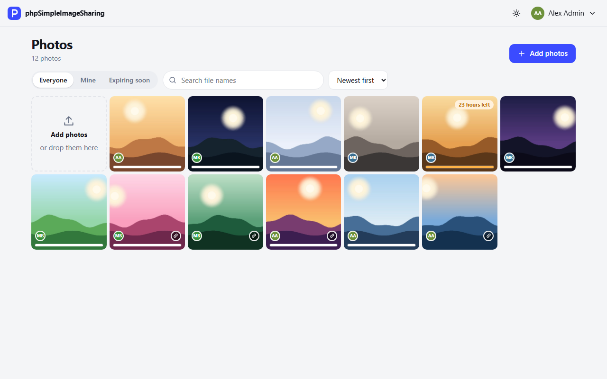
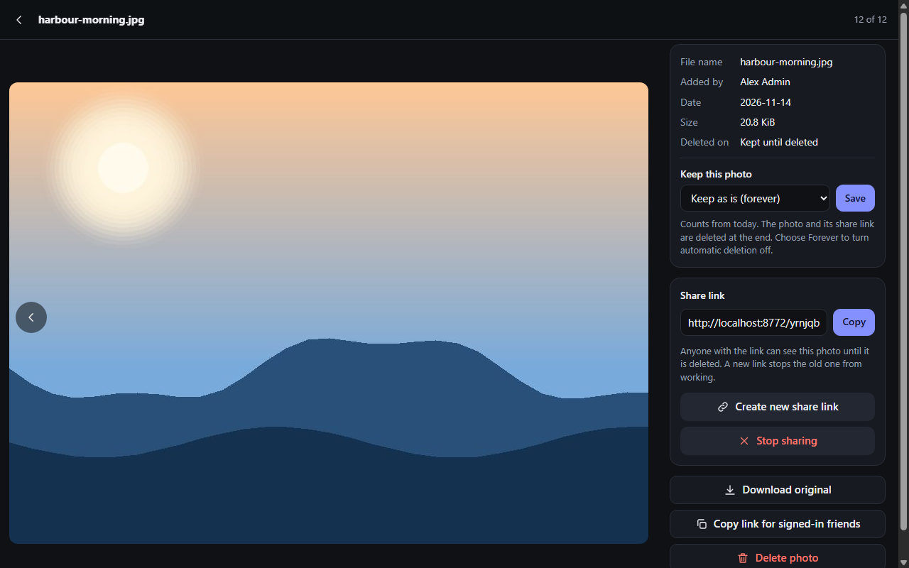
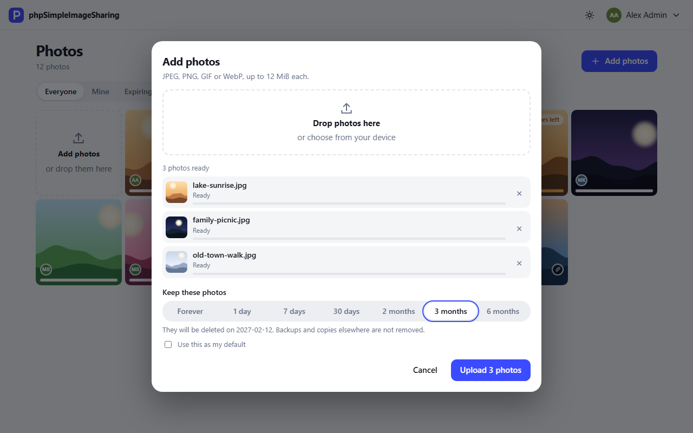

# phpSimpleImageSharing

[](https://github.com/Indiana8000/phpSimpleImageSharing/actions/workflows/lint.yml)
[](LICENSE)


A small, private photo album for friends that you host yourself. One PHP file plus a few classes, SQLite for data, no Composer, no cron, no external services. It runs on ordinary shared hosting.



<p>
  
  
</p>

## Features

- **Private by default.** The gallery and all original files require sign-in. Accounts are created by an administrator; there is no public registration.
- **Roles.** Administrators see everything and manage accounts. Members see all photos except those of guests. Guests see only their own photos.
- **Upload.** Drag and drop, many files at once, per-file progress and retry. JPEG, PNG, GIF and WebP up to 12 MiB (configurable).
- **Automatic deletion.** Keep a photo forever or delete it after 1, 7 or 30 days or 2, 3 or 6 months (months count as 30 days). The owner can change this at any time. Every person can save a default period. Expired files are removed during normal requests, so no cron job is needed.
- **Share links.** Create a public, unguessable link for a single photo, copy it again later, replace it or stop sharing. Links expire with the photo. Invalid, revoked or expired links redirect to a Rick Astley video.
- **Gallery tools.** Search, sort, filter (everyone, mine, expiring soon), paging, keyboard navigation, bulk copy of share links and bulk delete.
- **Diagnostics.** The administrator page shows PHP extensions, HTTPS detection, upload limits and storage use.
- **Interface.** Responsive, light and dark theme, system fonts only and no requests to other servers.

## Requirements

- PHP 8.4 with `fileinfo`, `session` and `pdo_sqlite`
- Apache 2.4 with `.htaccess` enabled (or equivalent protection for `config.php` and the share-link rewrite)
- HTTPS
- A writable data directory **outside** the public web root

## Installation

1. Upload the repository files to the directory served by your host.
2. Create a private directory outside the web root, for example `~/private/phpSimpleImageSharing-data`, with permissions `700` and write access for PHP.
3. Copy `config.example.php` to `config.php` and set `data_dir` to that directory. Choose the first administrator's username and display name.
4. Generate a password hash on your own computer (no shell access on the host needed) and put it in `config.php` as `password_hash`:
   ```
   php -r "echo password_hash('YOUR_LONG_PASSWORD', PASSWORD_DEFAULT), PHP_EOL;"
   ```
5. Open the site over HTTPS and sign in. Then remove `password_hash` from `config.php`; the database owns all credentials from now on.
6. Create an account for each friend under **People and system** in the account menu.

On first start the app creates `phpSimpleImageSharing.sqlite` in the data directory. Media files live in `users/<internal-user-id>/` below it. `config.php` is ignored by Git and blocked by the included `.htaccess`; never publish it.

## Operations

**Upload limits.** PHP's `upload_max_filesize` must be at least `max_upload_bytes` from `config.php`, and `post_max_size` a little higher. The browser gives each upload 120 seconds, so PHP and any proxy must allow enough time for your slowest expected connection. Keep free disk space for uploads and backups.

**Sessions.** Sign-in stays valid for 30 days of inactivity, even after the browser is closed, but never longer than 90 days in total. Session files are kept in `data_dir/sessions` so the host's own session cleanup cannot end them early. They do not need to be backed up.

**Updating.** Back up first, then upload the new files while keeping `config.php` and the data directory. A database created by a newer release cannot be opened by an older one.

**Backup and restore.** There is no in-app backup yet. A backup must contain the database and all user media from the same moment:

1. Ask people to stop uploading and block access to the app for a moment (for example `Require all denied` in `.htaccess`).
2. Copy the **entire** `data_dir`: `phpSimpleImageSharing.sqlite`, the full `users/` tree and any SQLite journal files. Store it privately, never under the web root.
3. Lift the block. To restore, block access again and put back one complete backup set (database and `users/` together), then check the gallery.

Automatic deletion only affects the live data directory. Copies in host or external backups stay until those backups expire, so give them their own retention period.

## Security notes

- Share tokens are 26-character random path tokens (`https://example.com/<token>`). They are bearer credentials: anyone with the link can see that photo. Web server access logs may contain them, so keep logs private.
- The token is stored in the database so the owner can copy the link again. Keep the data directory and its backups private.
- The HTTPS status check reads PHP's `HTTPS` variable. A reverse proxy that terminates TLS must pass the original scheme to PHP.
- Please report vulnerabilities privately, see [SECURITY.md](SECURITY.md).

## Roadmap

Video support is planned; see [todo.md](todo.md) for the product plan and open items.

## License

[MIT](LICENSE)
